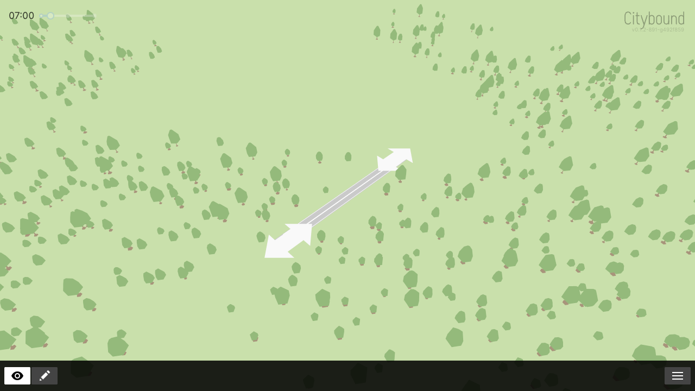

# Implemented-road reload evidence (#8)

## Finding

The disappearing-road symptom is **not reproduced** on accepted integration
`492f8597e9a60df69048cf5d6e33a3dbd233dc29`, built as
`v0.1.2-891-g492f859` on 2026-10-21 America/Los_Angeles. A fresh disposable city
retained its implemented straight road after both a browser reload and a clean
server shutdown/restart. No persistence or simulation fix is justified by this
result; this change adds a repeatable probe and evidence only.

Recommend classifying #8 as **not reproduced on the current accepted baseline**.
The original report used a stale binary, so it does not establish a current-source
persistence defect. Its historical root cause remains unknown. Broader town
continuity remains the scope of #41; a new trusted reproducer would warrant
reopening the road defect investigation. No issue or Project status was changed.

## Build and reproduction

All work was performed in the prepared `codex/issue-8-road-reload` checkout.
Neither browser assets nor the native binary existed there before this build.
The preserved [build identity](evidence/road-reload-492f859/build-identity.json)
records SHA-256 hashes of the native server, browser WASM, and browser JS.

The initial build command was:

```sh
CITYBOUND_COMPAT_BUILD_ROOT=/private/tmp/citybound-issue-8-build-492f859 \
CITYBOUND_ALLOW_LEGACY_LIFECYCLE=1 npm run build-compat
```

The contained browser build passed, including Rust/WASM compilation and Parcel
packaging. The native step selected the host's stable compiler and failed on
`compact`'s nightly feature requirement. This separate tooling bug is #68.
Explicitly selecting the preserved nightly then encountered the legacy registry
retrieval error already tracked by #29. The successful native build was:

```sh
CARGO_NET_GIT_FETCH_WITH_CLI=true \
RUSTUP_TOOLCHAIN=nightly-2020-03-10-x86_64-apple-darwin \
npm run build-server-debug-compat
```

The [initial build log](evidence/road-reload-492f859/build-attempt.log),
[registry failure](evidence/road-reload-492f859/legacy-registry-failure.log), and
[successful native build](evidence/road-reload-492f859/server-build.log) preserve
these outcomes separately. No toolchain, dependency, save-format, actor-layout,
or generated-code changes were made for either tooling discovery.

After `npm ci --ignore-scripts` at the repository root:

```sh
npm run test-road-reload-geometry
CITYBOUND_ROAD_EVIDENCE_DIR="$PWD/docs/audit/evidence/road-reload-492f859" \
npm run smoke-road-reload-compat
npm run smoke-family-house-reload-compat
npm run test-runtime-teardown-compat
```

The runtime probes launch their own headless Chromium, allocate loopback ports,
and use disposable cities. No user Chrome tabs or other worktrees are used.
The disposable cities are deleted after bounded teardown; the evidence directory
is retained. Native process inspection and loopback/browser execution required
running these probes outside the restricted command sandbox.

## What the road probe proves

The probe starts with no transport asphalt. It calls the same exported Rust
planning commands as the UI to create a road from `[-320, -300]` to
`[-220, -300]`, with one lane in each direction, and implements the project.
It waits for the generated endpoint geometry and the implemented master gesture.

It then switches to inspection mode, closes the menu, and checks that no project
remains active. The captured asphalt comes from `transport.rendering`, not from
`planning.rendering.currentPreview`. A fresh `BrowserTransportUI` broadcasts
`get_render_info` to authoritative server `Lane`/`SwitchLane` actors, which reply
with their stored paths. On save reload the server loads the mmap actor store
rather than calling `spawn_for_server`. Matching transport geometry in a fresh
page therefore exercises persisted lane paths and their replication/rendering
boundary, in addition to the implemented master-plan history.

Both server shutdowns must report `Stopping Citybound safely...` and exit with
code 0. The second startup must explicitly report `Loading from savegame`.
The save inventory includes `Lane_n`. No save files or actor state are injected.

| Boundary | Asphalt triangles | Marker triangles | Result |
| --- | ---: | ---: | --- |
| Implemented, before reload | 44 | 8 | Visible in inspection mode |
| Browser page reload | 44 | 8 | Same master gesture and geometry |
| Clean save/server restart, fresh page | 44 | 8 | Same master gesture and geometry |

Canonical indexed triangles preserve winding while ignoring batching, vertex
indices, and triangle insertion order. All three snapshots have identical hashes:

- Asphalt: `5682f1a271ea23f0bb0b0fd4c1942be12639e76c3d72db2b6cf259325fd6975c`
- Markers: `82d71f007c2da44edc7911069eb7699be5761877e583dd07c54061e44e12510d`

The fixed fixture has no switch-marker-gap triangles. The focused deterministic
check verifies that regrouping/reindexing preserves comparison results while
missing triangles, moved vertices, reversed winding, and lost markers are detected.
It tests the evidence comparator; it is not a claim of independent simulation
or storage-unit coverage.

Preserved [acceptance output](evidence/road-reload-492f859/acceptance.log),
[structured result and inventory](evidence/road-reload-492f859/result.json),
[first server log](evidence/road-reload-492f859/server-first.log), and
[restarted server log](evidence/road-reload-492f859/server-restart.log) record
zero browser errors and clean shutdowns. Trailing banner whitespace in the
server logs is normalized for repository storage. Full triangle snapshots are adjacent.




## Additional checks and limits

The existing family-house probe passed: the same developed house ID returned
wall, roof, and fence meshes after page reload and server restart, and residential
fill/outline meshes returned with no active project. It reported no browser errors.
See the [house/zone output](evidence/road-reload-492f859/house-zone-reload.log).
The focused geometry test, JavaScript syntax check, and `git diff --check` passed.
The existing [teardown regression](evidence/road-reload-492f859/teardown.log)
also passed; its refusal/escalation messages are expected negative fixtures.

This is same-build continuity for one fixed straight road with its generated
endpoints. It does not test intersections between multiple roads, curved/multilane
networks, in-flight construction, vehicle routing, cross-version migration,
historical saves, or the original stale artifact. The screenshots were visually
inspected; no pixel-diff assertion or visible user-browser session is claimed.
